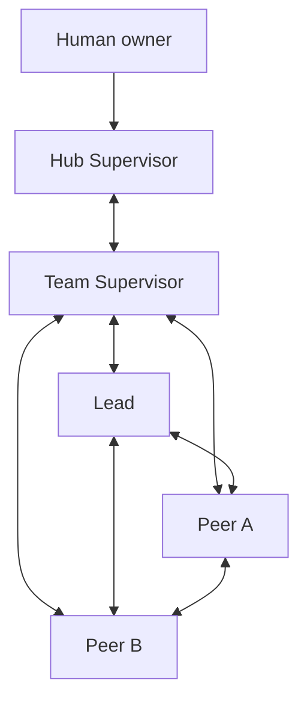
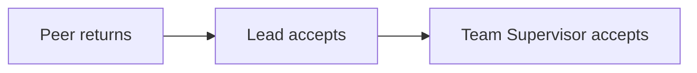

SLP v2 has four roles. The Human remains the owner above the system, but is not
an additional team seat.

SLP is a cooperative-agent protocol, not a shell security sandbox. Maestro
checks the nine SLP operations at their supported boundaries: Hub operations
must run from the Hub room, while project role operations require the current
generation's stored Herdr pane binding. It does not block native commands,
administrative Maestro commands, or direct Herdr calls; topology and
external-effect limits remain obligations enforced by the Human and host
policy. Within those operations, `MAESTRO_SESSION_ID` and
`MAESTRO_SESSION_PID` do not grant an SLP role; a missing, mismatched, or
prior-generation pane binding fails closed. The pane identity is
`HERDR_PANE_ID`, or, when an agent's shell dropped the variable, the value the
nearest ancestor process still carries.

## Topology

Every double arrow is a direct conversation channel in the SLP protocol. The
supported Hub flow has no Hub-to-Lead or Hub-to-Peer channel, except in the
lead-only shape below; unrestricted Herdr itself is outside that guarantee.

A generation runs in one of two shapes, pinned when it starts. The diagram
above is the supervised shape, the default: a Team Supervisor above a Lead and
its Peers. `maestro team start --lead-only` opens the other shape, one Lead
plus the runtime pane and no Team Supervisor. In that shape the Hub Supervisor
is the Lead's reviewer: it receives the `RETURNED` line, accepts with `maestro
work accept` or grants one retake with `maestro work note <id> "<specific gap>"
--rework`, and it is also the seat above, so the Lead's `--blocked` and
`--owner` notes climb to it. The boundary below is unmoved: a Peer's reviewer
is still its Lead in either shape. The shape belongs to the generation, so
re-running `team start` without the flag does not reshape a live team.

## Authority

| Role | Owns | SLP operations |
| --- | --- | --- |
| Hub Supervisor | team creation, cross-team status, owner decisions, emergency stop, and review of a lead-only Lead | `team start`, `team stop` (normal for a lead-only team, `--emergency` for a supervised one), `status`, `work accept` and `work note --rework` on a lead-only Lead's return, `decide` |
| Team Supervisor | team coordination and acceptance | `team stop`, `status`, `work add`, `work note`, `work accept`, `decide` |
| Lead | technical coordination, its own implementation work, and Peer acceptance | `status`, `work add`, `work take`, `work note`, `work return`, `work accept`, `decide` |
| Peer | bounded execution and independent judgment | `status`, `work take`, `work note`, `work return` |

The three team seats (Team Supervisor, Lead, Peer) run as native harness
profiles (`claude --agent maestro-<name>` or `codex --profile
maestro-<name>`) rendered by `maestro install` into the seat config dir
`~/.maestro/claude/<seat>/agents/maestro-<name>.md` (each Claude seat runs
under its own `CLAUDE_CONFIG_DIR`, with its own settings, skill allowlist and
deny list; d845) and the Codex profile files, from the profile file the
Workspace Pack names; the mandate is the seat's system prompt, so it survives
`/clear` and compaction. A seat is changed by a
shadowing file, `~/maestro/profiles/<seat>.md` or
`<project>/.maestro/profiles/<seat>.md`, not by a flag; the one flag is
`team start --peer-profile <name>` for one generation's Peers. The Hub
Supervisor is the owner's own agent in `~/maestro` and has no profile;
`team start` records its pane so the team's upward wakes reach it (d841).
There is no Observer seat. Attention is the seat's own `work note --blocked`,
pushed one seat up, plus the generation's runtime pane, which turns a
`blocked` or idle-while-holding pane into a `stall:dialog` or `stall:silence`
entry and the `[from runtime]` nudge (Hub d96, d97); no model judges
attention. See [Seat profiles](/getting-started/slp-setup/#seat-profiles).

## Hub Supervisor

The Hub Supervisor lives in `~/maestro`. It starts teams, maintains the
canonical Workspace Pack, reads cross-team status and records owner or
cross-team decisions. It communicates with each team only through that team's
Team Supervisor, with one exception: a lead-only generation has no Team
Supervisor, so the Hub Supervisor is that Lead's reviewer, reads its returned
work, accepts it or grants `--rework` on it, and receives its `--blocked` and
`--owner` notes. That reach covers a lead-only team's Lead only; a supervised
team is still reached through its Team Supervisor, and a Peer is never managed
directly in either shape.

External effects still require Human authority. Recording a decision does not
execute its native tool.

### Owner presence and provisional rulings

The room store holds the owner's declared presence, `here` or `away`. The Hub
Supervisor records it with `maestro owner here|away` on the owner's own words
in its pane, and `maestro owner` prints it; the Hub prompt line and the room's
`maestro status` carry `owner: here|away`. No hook and no other seat infers it,
and a `[from <role>]` push line never counts as the owner.

Presence changes only who answers an owner-scope `--blocked` note that has
reached the Hub, never what a seat may do. While the owner is `here`, the Hub
waits for her. While she is `away`, it resolves the fork at once through
advisor review, records the ruling as `maestro decide "<choice>" --why "<reason>" --work <id>
--provisional`, and pushes it down so the team continues. That `maestro status`
lists every provisional ruling until the owner confirms it with `maestro
decision confirm <id>` or supersedes it with a decision that `--replaces` it,
and the `away` line counts how many wait. `away` never grants commit, push,
tag, release, install mid-generation, or any destructive change.

Like `decision`, `maestro owner` and `maestro decision confirm` are Hub-room
verbs, not SLP operations; `--provisional` is a Hub-only option on `decide`.
The public surface stays at nine operations.

## Team Supervisor

The Team Supervisor is the team's record holder and acceptance owner. It
communicates directly with the Hub Supervisor, Lead and every Peer. It assigns
work to the Lead, accepts Lead returns and stops the team when all work is
done.

## Lead

The Lead owns technical decomposition, integration, verification strategy and
Peer acceptance, and it implements. Working its own items is the default path:
it takes the item `team start` hands it, and any item it has not already
assigned to a Peer, and finishes it itself. `maestro work add "<objective>"`
with no `--to` opens an item for the Lead in its own team, `OPEN` with the Lead
as assignee, opening no pane and pushing no line; the Lead then takes it with
`maestro work take <id>`. An item that is already a Peer's stays the Peer's:
when it comes back wrong the Lead notes it or grants rework rather than
finishing it. Its own returns are reviewed by its reviewer, the Team Supervisor
in the supervised shape and the Hub Supervisor in a lead-only generation, and
it never accepts its own work.

A Peer is opened the way a harness opens a sub-agent, never as the default path
for every item: a bounded piece worth briefing and reviewing, two pieces that
touch different files and can run at once, or a context-heavy investigation
whose noise would eat the Lead's own context. Any one of the three is reason
enough, even when the diff would be small; `maestro work add "<objective>" --to
<peer>` reuses or opens that Peer. Until the Lead can write both a bounded
objective and its acceptance, the work is its own. The exception that never
moves is coordination work: briefs, reviews and technical decisions stay with
the Lead, which communicates directly with the Team Supervisor and every Peer.

## Peer

A Peer takes work assigned to its identity, records material notes and returns
results. It reaches the Team Supervisor, the Lead and other Peers only through
recorded work notes and returns, which Maestro pushes to the seat they
concern; its seat denies `herdr` (d847). It does not accept its own work and
does not settle team decisions.

## The `--blocked` ladder and owner walk-ins

A `--blocked` fork climbs one seat at a time (Peer to Lead, Lead to Team
Supervisor, Team Supervisor to the Hub, and Lead to the Hub in a lead-only
generation), and every seat filters. A technical question is answered by the
seat that owns it, so a Lead decides it rather than passing it on, and a fork
reaches the seat above only when the seat below cannot resolve it.

The same note carries an objection. A seat that can show its item rests on a
false premise (a failing case, a line of code, a measurement) records the
premise, the evidence and what the item would become as a `--blocked` note
before it builds; a doubt it cannot yet back is a plain note and it proceeds.
The right to object is not a duty to find one. The seat that receives the
objection rules on it either way with `maestro decide --work <id>`, which wakes
the holder: changing the plan needs evidence and keeping it needs a reason.
When the premise falls, the holder returns what it has, the reviewer closes the
item with `maestro work accept <id> --outcome cancelled` and opens new work, and
a ruling that changes what another item rests on is recorded on that item too.

The Team Supervisor is the owner's embodiment inside its team. It normally
resolves what reaches it, by its own judgment or through advisor or council
review, neither of which is a team seat, and records the ruling as a decision
in team scope; it asks the Hub with its own `--blocked` note only when it
cannot. The Hub decides what a Hub Supervisor may decide and puts to the owner
only what is hers; in a lead-only generation the Hub takes the Team
Supervisor's part for its Lead.

When the owner types directly into a seat's pane, that message is an owner
instruction. The seat records it first as `maestro work note <id> "owner asked:
<what>" --owner`: provenance only, exclusive with `--blocked` and `--rework`,
it stops nobody, sets no blocked flag, and pushes `[from <role>][<work-id>
OWNER]` one seat up so the seat above sees where the instruction came from.
Inside the item's objective the seat acts at once; outside it, it records the
note and does not widen the item, and the Lead reads the push and opens new
work. A walk-in never rewrites an objective or an acceptance, and never
redefines a seat's mandate. Seats have no question tool: a question for the
owner is `maestro work note <id> "<question>" --blocked`, never a dialog.

## Conversation and records

Natural conversation needs no record ID. Chat alone does not mutate work,
authority or accepted decisions. Record these changes before they govern:

- changed objective or acceptance: create new work; the existing contract is immutable;
- material context on the same contract: `maestro work note`;
- settled technical, team or owner choice: `maestro decide`;
- a fact only the seat above can settle, while keeping the item: `maestro work note --blocked`;
- evidence that the item rests on a false premise, before building: `maestro work note --blocked`, ruled on with `maestro decide --work`;
- an owner instruction typed into the seat's pane: `maestro work note --owner`;
- completed or blocked execution: `maestro work return`;
- reviewer acceptance: `maestro work accept`.

## One acceptance boundary above the worker

This keeps execution and acceptance separate without adding review roles or a
second lifecycle. In a lead-only generation the upper step is the Hub
Supervisor accepting the Lead's return; the lower one is unchanged.
