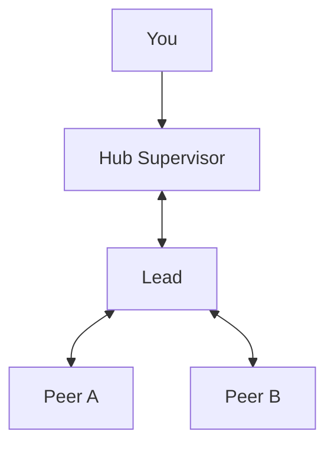
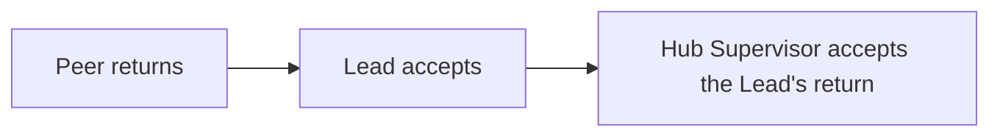

SLP, the team layer, is a plugin that is off by default. Enable it with
`maestro plugin enable slp` in the Hub room and in the project; see
[SLP setup and storage](/getting-started/slp-setup/).

An SLP team has three roles: the Hub Supervisor, one Lead, and the Peers the
Lead opens. You, the owner, stand above all three and are not a team seat.

SLP is a cooperative-agent protocol, not a shell security sandbox. Maestro
checks the nine SLP operations at their supported boundaries: Hub operations
must run from the Hub room, while project role operations require the current
generation's stored Herdr pane binding. It does not block native commands,
administrative Maestro commands, or direct Herdr calls; topology and
external-effect limits remain obligations enforced by the owner and host
policy. Within those operations, `MAESTRO_SESSION_ID` and
`MAESTRO_SESSION_PID` do not grant an SLP role; a missing, mismatched, or
earlier-generation pane binding fails closed. The pane identity is
`HERDR_PANE_ID`, or, when an agent's shell dropped the variable, the value the
nearest ancestor process still carries.

## Topology

A team has one shape. The Hub Supervisor reviews the Lead, and the Lead hands
bounded work to Peers and reviews what they return. The Hub never manages a
Peer directly.

## Authority

| Role | Owns | SLP operations |
| --- | --- | --- |
| Hub Supervisor | team start and stop, cross-team status, owner and cross-team decisions, review of the Lead | `team start`, `team stop`, `status`, `work note` (plain or `--rework`) and `work accept` on the Lead's items, `decide` |
| Lead | technical coordination, its own implementation work, and Peer acceptance | `status`, `work add`, `work take`, `work note`, `work return`, `work accept`, `decide` |
| Peer | bounded execution and independent judgment | `status`, `work take`, `work note`, `work return` |

The Lead and Peer run from their seat files, `lead.md` and `peer.md`, which
`maestro install` renders for Claude Code and Codex. The mandate is the seat's
system prompt, so it survives `/clear` and compaction. You change a seat by
placing your own copy in `~/maestro/profiles/` or
`<project>/.maestro/profiles/`, not by a flag; the only launch flags are
`--lead-model` and `--peer-model` on `team start` and `--model` on
`work add --to`. See [Seat files](/getting-started/slp-setup/#seat-files).

## Hub Supervisor

The Hub Supervisor is your own agent session in `~/maestro`. It has no seat
file. It starts teams, keeps the Workspace Pack at `~/maestro/SLP.md`, reads
cross-team status, and records owner or cross-team decisions with
`maestro decide --scope owner|cross-team`.

It is the Lead's reviewer and the seat above the Lead. It reads the Lead's
returned work and accepts it with `maestro work accept` or grants one retake
with `maestro work note <id> "<specific gap>" --rework`. A plain
`maestro work note <id> "<text>"` on the Lead's item reaches the Lead's pane as
`[from hub-supervisor][<id> NOTE]`; it is the one plain note in SLP that wakes
anyone. The Lead's `--blocked` notes reach the Hub, and the Hub's
`maestro status` lists each one as `blocked for the Hub: <team-id>:<id>
<note>` until a ruling with `--work <team-id>:<id>` answers it.

Run the Hub as the Herdr agent named `supervisor` in the `maestro` workspace,
so acceptance and stop notices reach its pane.

Recording a decision does not run any external effect. Push, publish, deploy
and delete still need your word.

## Lead

The Lead owns technical decomposition, integration, verification strategy and
Peer acceptance, and it implements. Working its own items is the default path:
it takes the item `team start` hands it, and any item it has not already
assigned to a Peer, and finishes it itself. `maestro work add "<objective>"`
with no `--to` opens an item for the Lead in its own team, `OPEN` with the
Lead as assignee, opening no pane and pushing no line; the Lead then takes it
with `maestro work take <id>`. An item that is already a Peer's stays the
Peer's: when it comes back wrong the Lead notes it or grants rework rather
than finishing it. The Hub Supervisor reviews the Lead's returns, and the Lead
never accepts its own work.

A Lead opens a Peer the way a harness opens a sub-agent, not as the default
path for every item. Any one of these is reason enough: a bounded piece worth
briefing and reviewing, two pieces that touch different files and can run at
once, or a context-heavy investigation whose noise would fill the Lead's own
context. `maestro work add "<objective>" --to <peer>` reuses or opens that
Peer. Until the Lead can write both a bounded objective and its acceptance,
the work stays its own. Briefs, reviews and technical decisions always stay
with the Lead.

## Peer

A Peer takes work assigned to it, records material notes and returns results.
It reaches the Lead and other Peers only through recorded work notes and
returns, which Maestro pushes to the seat they concern; its seat denies
`herdr`. It does not accept its own work and does not settle team decisions.

## The `--blocked` ladder and owner walk-ins

A `--blocked` note climbs one seat at a time, Peer to Lead and Lead to the
Hub, and every seat filters. A technical question is answered by the seat that
owns it, so a Lead decides it rather than passing it on. A question reaches
the Hub only when the Lead cannot settle it. The Hub resolves what it may
decide and brings to you only what is yours.

The same note carries an objection. A seat that can show its item rests on a
false premise (a failing case, a line of code, a measurement) records the
premise, the evidence and what the item would become as a `--blocked` note
before it builds; a doubt it cannot yet back is a plain note and it proceeds.
The seat that receives the objection rules on it either way with
`maestro decide --work <id>`, which wakes the holder: changing the plan needs
evidence and keeping it needs a reason. When the goal or the acceptance
itself falls, the holder returns what it has, and the reviewer closes the item
with `maestro work accept <id> --outcome cancelled` and opens new work.

When you type directly into a Lead or Peer pane, that message is an owner
instruction. The seat records it first as `maestro work note <id> "owner
asked: <what>" --owner`, which pushes `[from <role>][<work-id> OWNER]` one
seat up and sets no blocked flag. Inside the item's objective the seat acts at
once; outside it, the seat records the note and does not widen the item, and
new work is opened for it. A walk-in never rewrites an objective or an
acceptance. Seats have no question tool: a question for you is a `--blocked`
note, never a dialog.

## Conversation and records

Chat alone does not change work, authority or decisions. Record these changes
before they govern:

- changed objective or acceptance: create new work; the existing contract is immutable;
- material context on the same contract: `maestro work note`;
- a settled technical or owner choice: `maestro decide`;
- a fact only the seat above can settle, while keeping the item: `maestro work note --blocked`;
- evidence that the item rests on a false premise, before building: `maestro work note --blocked`, ruled on with `maestro decide --work`;
- an owner instruction typed into the seat's pane: `maestro work note --owner`;
- completed or blocked execution: `maestro work return`;
- reviewer acceptance: `maestro work accept`.

## One acceptance boundary above the worker

Execution and acceptance stay separate without extra review roles or a second
lifecycle.
