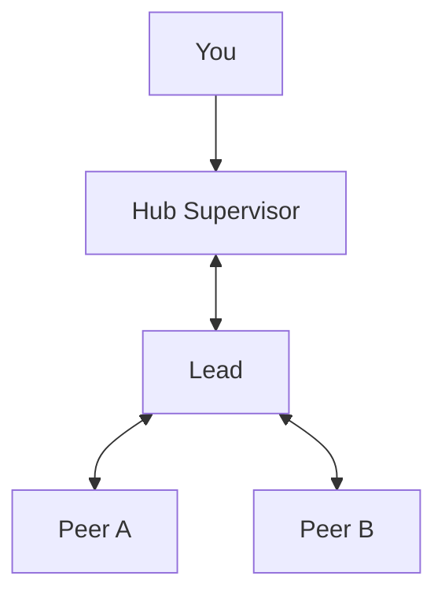
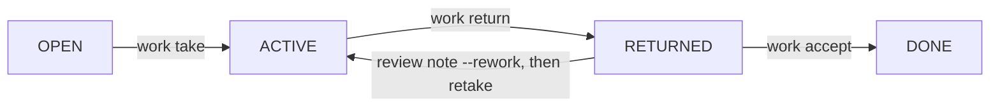

An SLP team is one generation (one run of the team) with exactly one Lead and
zero or more Peers, reviewed by your Hub agent. Maestro stores the work and
decisions; Herdr provides the live workspace and panes.

SLP is a built-in plugin that is off by default. Enable it in the Hub room and
in the project before you start:

```sh
cd ~/maestro && maestro plugin enable slp
cd /absolute/path/to/project && maestro plugin enable slp
```

`maestro team start` also enables it in the project it starts. For paths, seat
files and data ownership, read [SLP setup and storage](/getting-started/slp-setup/).

## Topology



The Hub Supervisor is your own agent session in `~/maestro`. It starts the
team, reviews the Lead's returned work, and never manages Peers directly. The
Lead works its own items and opens a Peer for a bounded piece worth handing
off. A Peer reaches the Lead only through recorded work notes and returns.

No model watches the team. The only pane that is not a seat is the
generation's runtime pane, a foreground process with no model. Each seat
launches from its seat file, rendered by `maestro install` (see
[Seat files](/getting-started/slp-setup/#seat-files)).

SLP is a cooperative-agent protocol, not a shell security sandbox. Maestro
checks the nine SLP operations at their supported boundaries: Hub operations
must run from the Hub room, while project role operations require the current
generation's stored Herdr pane binding. It does not block native commands,
administrative Maestro commands, or direct Herdr calls; topology and
external-effect limits remain obligations enforced by the owner and host
policy.

## Public operations

SLP roles use exactly nine operations:

```text
maestro team start
maestro team stop
maestro status [work-id]
maestro work add
maestro work take
maestro work note
maestro work return
maestro work accept
maestro decide
```

Flags configure one operation; they are not separate tools. Other Maestro
commands stay outside the team's toolbelt.

## Start

The Hub Supervisor runs start from the Hub room:

```sh
cd ~/maestro
maestro team start /absolute/path/to/project "<observable objective>"
```

One call pins the Workspace Pack and both seat files, creates one Herdr
workspace, opens the Lead and waits for it to acknowledge, opens the runtime
pane, records the Hub Supervisor's pane as the target of the team's upward
wakes, and creates initial `OPEN` work for the Lead. `--lead-model` and
`--peer-model` pick the model each seat launches with.

Peers have no lifecycle command. The Lead creates assigned work and Maestro
reuses or opens the named Peer in the same operation, then wakes that pane
with `[from lead][<id> OPEN] <objective>; read: maestro status <id>`:

```sh
maestro work add "<bounded objective>" --to peer-api
```

`maestro work add "<objective>"` with no `--to` opens an item for the Lead
itself, with no pane opened and no line pushed.

## Work lifecycle



- `work add` creates assigned `OPEN` work. Inside a team it refuses
  `--acceptance` and `--blocked-by`; write the acceptance condition and any
  ordering into the objective text.
- `work take` lets the assignee take `OPEN` work, or `RETURNED` work with the
  unused reviewer grant for its current return revision.
- `work note` records material context without changing state.
- `work note --blocked` keeps the state and pushes
  `[from <role>][<id> BLOCKED] <summary>; read: maestro status <id>` to the
  seat above: Peer to Lead, Lead to the Hub Supervisor.
- `work return` carries the result, proof, blocker and residual risk when they
  apply.
- `work accept` is run by the reviewer: the Lead accepts Peer work and the Hub
  Supervisor accepts Lead work.

Nobody accepts their own work. A holder that needs a fact from above records
`work note --blocked` and keeps the item; a holder that cannot continue
returns it with the blocker. There is no `BLOCKED` state. Rework is
`work note --rework` by the reviewer, followed by one retake by the same
assignee.

A reviewer may close `OPEN` or `RETURNED` work as cancelled:

```sh
maestro work accept <work-id> --outcome cancelled
```

`ACTIVE` work must return first unless the Hub emergency-stops the team.

## Decisions

Record a settled choice in one operation:

```sh
maestro decide "<choice>" --why "<reason>" --work <work-id>
```

`--work` links the item and wakes the seat that holds it with a `DECIDED`
line. At the Hub, a unique work id resolves directly; if the same id exists in
several teams, qualify it as `<team-id>:<work-id>`. Use
`--replaces <decision-id>` to replace an older decision. Unsettled discussion
stays in a work note.

The Lead decides technical scope, and the Hub Supervisor decides owner or
cross-team scope (`--scope owner|cross-team`). Peers propose through a work
note.

## Status

```sh
maestro status
maestro status <work-id>
```

Status is read-only and scoped to the caller. At the Hub it lists teams,
generations, runtime pane state, missing panes, and every escalation waiting
on the Hub as `blocked for the Hub: <team-id>:<id> <note>`. In a team pane it
lists the team's unfinished items, with `*` on those waiting on the caller (a
Peer sees only its own), and collapses `DONE` items into a count that `--all`
expands. `maestro status <work-id>` prints one item and ends with a `next:`
line naming what the caller may run. The text shows one line of the
objective; `--json` prints all of it.

## Runtime pane

`team start` opens one runtime pane per generation through Maestro's Herdr
plugin; the pane runs `maestro slp runtime` with the team and generation in
its environment. It is not an agent: it holds the generation's Herdr event
subscription, renders the team's pane output, and resolves every event
against the store. It never takes, returns, accepts or decides. Status shows
`runtime pane on|off`. A repeated `team start` reopens a missing one, a
generation whose pane did not open fails with `RUNTIME_PANE_FAILED` naming
`maestro install`, and `maestro slp restore`, the plugin's startup hook,
brings it back after a Herdr restart. Its lock and queue state are temporary
and are deleted at stop. `maestro slp status` from a team pane reads them
while the generation runs.

## Attention

Attention has two layers. The first is the seat's own blocked note:

```sh
maestro work note <work-id> "<what you need>" --blocked
```

Maestro flags the note and pushes `[from <role>][<id> BLOCKED] <summary>;
read: maestro status <id>` one seat up. Each seat answers what it can: the
Lead settles a technical question itself, and only a question the Lead cannot
settle reaches the Hub.

The second layer is the runtime pane, which needs no model. An idle pane that
still holds ACTIVE work becomes a `stall:silence` entry on that item, unless
its latest entry is a `--blocked` note. The entry is recorded by the actor
`runtime` and pushed to the silent pane as `[from runtime][<id>] silence
<evidence>; stop and run: maestro work note <id> "<what you need>" --blocked`,
with a copy to the Hub, once per item until the store changes. An idle seat
with nothing waiting on it wakes the seat above with `[attention] <seat>
idle`. A seat pane that exits or closes is noted on the team record and wakes
the Hub with `[attention] <seat> pane exited|closed`. A wake for a seat that
is still working waits for that seat's next idle.

Wakes to the Hub go to the pane `team start` recorded, or to a Herdr agent
named `supervisor` in the `maestro` workspace. A wake that resolves to neither
is dropped, and `maestro slp status` lists it as `unreachable`. The store
remains the truth either way.

## Stop

The Hub Supervisor stops a team once every item is `DONE`:

```sh
cd ~/maestro
maestro team stop <team-id> --reason "<closing report>"
```

Normal stop changes nothing while unfinished work remains and lists those
items. Once all work is `DONE`, it closes the Peers, the Lead, the runtime pane
and its temporary directory, then the workspace. Maestro records `STOPPED`
only after the workspace is gone, and the Hub's `maestro status` prints
`<team> g<n> STOPPED (supervisor): <closing report>`. A partial close stays
`RUNNING`, so repeating the same command continues cleanup. The pinned pack
and durable records remain.

To abandon unfinished work, the Hub Supervisor uses an emergency stop:

```sh
cd ~/maestro
maestro team stop <team-id> --emergency --reason "<why this generation is abandoned>"
```

Unfinished work keeps its current `OPEN`, `ACTIVE`, or `RETURNED` value and is
marked abandoned with actor, reason, generation, and time. The next start
creates new work in a new generation and cannot change the abandoned records.
